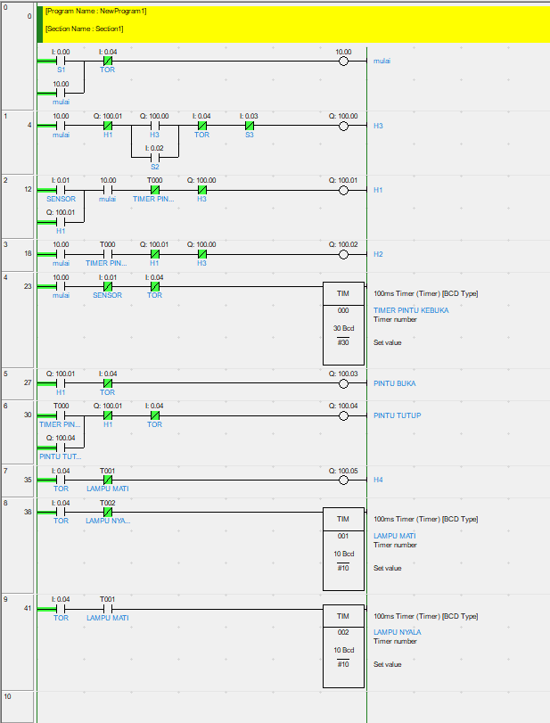

# PLC-Pintu-Lift-elevator-door

 

 
A PLC program sequence for an automatic elevator door, created back when I was in vocational high school (SMK).

## 🔍Inputs:
- SW1 (for starting)
- Sensor (for detecting people)
- TOR (for safety)
###   ↓
## 🧠PLC
- CP1E
###   ↓
## 🚪Outputs:
- Motor
- 3 types of LEDs

